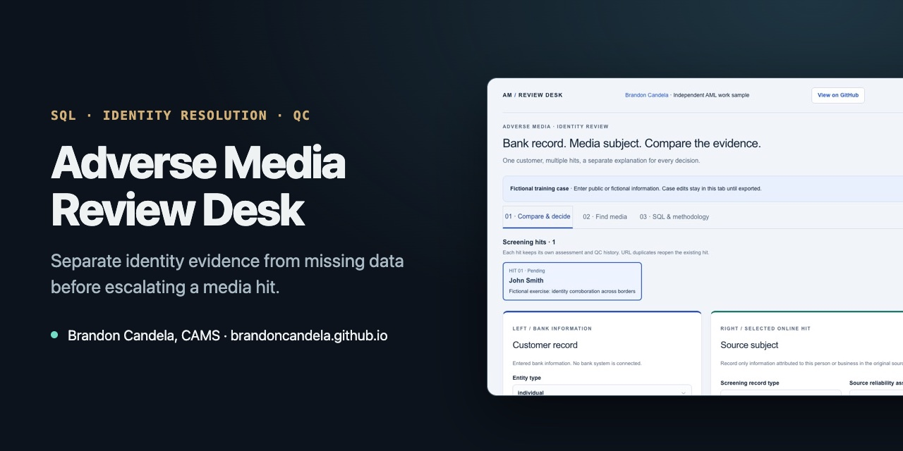

# Adverse Media Review Desk



**[▶ Open the live demo](https://brandoncandela.github.io/adverse-media-review-desk/)** · [Portfolio](https://brandoncandela.github.io/) · [LinkedIn](https://www.linkedin.com/in/brandon-candela/) · Built by Brandon Candela, CAMS, PMP

> **What this shows:** how to decide whether a news story is really about your customer, and how SQL can make that triage logic clear enough to check.

## The problem

Name screening finds news articles that mention someone with your customer's name. Most are about someone else. The analyst has to compare what the bank knows with what the article says, and explain the call. The common mistake is treating missing information as a mismatch: if the article has no date of birth, that doesn't rule the customer out.

## Try it

1. Open the [live demo](https://brandoncandela.github.io/adverse-media-review-desk/). It starts with a fictional "John Smith" case.
2. Compare the bank record on the left with the article subject on the right. Each identifier is marked as a match, close variant, conflict or unknown.
3. Find more articles with the built-in news search, open a Google search, or add an article by hand.
4. Decide: escalate, rule it out, or ask for more information. Write why.
5. Open the **SQL & methodology** tab to load the nine training cases, each of which tests a tricky situation.

## The triage rules

| Situation | Outcome |
| --- | --- |
| Name and full date of birth match | Escalate, even if the location differs. People move. |
| Name matches, other identifiers unknown | Escalate. Unknown isn't disproved. |
| A verified, sourced identifier conflicts | Can support ruling the hit out. |
| Location differs and nothing else conflicts | Never enough on its own to rule it out. |

The same logic lives in two places: [`lib/matching.ts`](lib/matching.ts) for the interface, and a SQL view for the training data.

## The SQL

The nine training cases and their 27 identifier comparisons are SQLite tables, built from three files in [`sql/migrations/`](sql/migrations):

| File | What it shows |
| --- | --- |
| [`0000_training_cases.sql`](sql/migrations/0000_training_cases.sql) | Tables, foreign keys and the training data |
| [`0001_verified_dob_conflict_case.sql`](sql/migrations/0001_verified_dob_conflict_case.sql) | A case where a verified date-of-birth conflict rules the hit out |
| [`0002_training_triage_view.sql`](sql/migrations/0002_training_triage_view.sql) | A view that turns comparisons into an outcome, using a CTE, `CASE`, conditional aggregation and JSON extraction |

[`scripts/export-examples.mjs`](scripts/export-examples.mjs) runs the migrations in SQLite and exports the cases with their SQL-derived outcome for the demo. To query the data yourself:

```sh
sqlite3 :memory: ".read public/data-model.sql"
```

```sql
-- Workload by outcome
SELECT disposition, COUNT(*) AS cases FROM training_triage GROUP BY disposition;

-- Which identifiers are most often missing (unknown, not a mismatch)
SELECT field, COUNT(*) AS unknowns FROM comparison_examples
WHERE state = 'unknown' GROUP BY field ORDER BY unknowns DESC;

-- Cases where the SQL view disagrees with the expected outcome (should return nothing)
SELECT t.id, t.expected_disposition, v.disposition
FROM training_cases t LEFT JOIN training_triage v ON v.id = t.id
WHERE v.id IS NULL OR t.expected_disposition <> v.disposition;
```

`public/data-model.sql` also sketches tables for a full case store. That part is a design proposal, not something the demo uses.

## Run it locally

Node 22.13 or later.

```sh
npm install
npm run dev     # local server
npm test        # 20 matching and review tests
npm run build   # exports examples.json, then builds the static site in pages-dist/
```

| Path | What's in it |
| --- | --- |
| `app/page.tsx` | The review interface |
| `lib/matching.ts` | Identifier comparison and triage rules |
| `lib/reviews.ts` | Multiple hits per case, QC snapshots and export |
| `lib/news.ts` | News search through the free GDELT API |
| `sql/migrations/` | The SQLite schema, training data and triage view |

## Limits

- Matching is rule-based. It doesn't score how likely a match is, because that needs real, verified match data to calibrate.
- Name handling is basic. It knows supplied aliases and common US/UK country abbreviations, not transliterations or phonetic matches.
- The GDELT news search covers three months and English keywords, and GDELT sometimes rate-limits requests. Google and manual import are always available.
- An allegation in the news isn't proof of wrongdoing, and all names in the sample data are fictional.

Built with AI coding tools. References: [Wolfsberg negative news screening FAQs](https://wolfsberg-group.org/news/publication-of-the-negative-news-screening-faqs/) and the [GDELT DOC API](https://blog.gdeltproject.org/gdelt-doc-2-0-api-debuts/).
